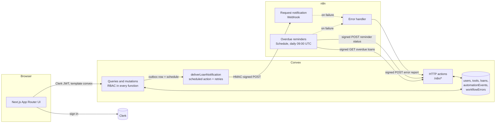

# LendLoop

**Borrow what you need. Lend what you don't.**

A neighborhood tool-lending board. Neighbors list tools, request to borrow them for a date range,
and the owner approves or declines. Notifications and overdue reminders run through n8n.

- **Next.js 15 (App Router)** for the UI
- **Clerk** for sign-in
- **Convex** for data, backend logic and access control
- **n8n** (self-hosted with Docker) for the two automations plus an error workflow

---

## Contents

1. [What it does](#what-it-does)
2. [Architecture](#architecture)
3. [Local setup](#local-setup)
4. [Environment variables](#environment-variables)
5. [Security decisions](#security-decisions)
6. [Data minimisation](#data-minimisation)
7. [Reliability: retries, idempotency, failures](#reliability-retries-idempotency-failures)
8. [Tests](#tests)
9. [Project structure](#project-structure)
10. [What I'd change for production](#what-id-change-for-production)

More detail: [`docs/security.md`](docs/security.md) · [`docs/production.md`](docs/production.md)

---

## What it does

**Public page** (`/`): the tagline, a read-only list of available tools (name and category only),
and a **Sign in to lend or borrow** button wired to Clerk.

**Signed in** (`/dashboard`):

| View | What you can do |
| --- | --- |
| Browse tools | See every tool with its availability, filter by category, request a date range |
| My listings | List a tool (name, category, condition, description), edit or delete your own |
| My requests | Track your requests, cancel pending ones, see automation activity ("Overdue reminder · sent 2 days ago") |
| Incoming requests | Approve or decline requests for your tools, mark loans returned |
| Admin (admins only) | Remove any listing, view all loans, mark Trusted Lenders, see failed automations and retry them |

**Rules**

- `user`: create, edit and delete only their own listings; act only on requests for their own tools
  or their own borrowing.
- `admin`: remove any listing, view all loans, mark a lender as Trusted Lender.
- No borrowing your own tool, no double booking (approving a request declines clashing ones),
  loans are at most 30 days, start dates can't be in the past.
- An owner can't delete a tool that is out on loan. Deleting a listing cancels its open requests
  and notifies those borrowers.

---

## Architecture



### Request notification (Convex → n8n)

1. A mutation changes a loan, e.g. `loans.request` or `loans.decide`.
2. In the **same transaction** it writes an `automationEvents` row (status `pending`, idempotency key
   `<loanId>:<event>`) and schedules `automation.deliverLoanNotification`. This is a transactional
   outbox: if the mutation rolls back, nothing is queued; if it commits, delivery will be attempted.
3. The action builds a minimal payload, signs it with HMAC-SHA256 and POSTs it to the n8n webhook.
4. **n8n** verifies the signature and timestamp, skips event IDs it has already handled, "sends" the
   notification (a logged mock; see below), then responds `200`. If sending fails, it responds `500`
   (so Convex retries) and then fails the execution, so the error workflow runs.
5. Convex records `sent`, or schedules a retry with exponential backoff (30s, 1m, 2m, 4m). After 5
   attempts, or on a 4xx such as a bad signature, the event becomes `failed` and shows up for admins.

| Event | Notified |
| --- | --- |
| `loan.created` | owner |
| `loan.cancelled` (borrower withdrew) | owner |
| `loan.approved` / `loan.declined` / `loan.returned` | borrower |
| `loan.listing_removed` | borrower |

### Overdue reminders (n8n → Convex)

1. **Schedule trigger** runs daily at 09:00 UTC. A **Run now (manual)** trigger runs the same path on
   demand.
2. **Sign request** → **GET `/n8n/overdue-loans`** returns approved loans past their end date that
   haven't had a reminder *today*, each with a `reminderKey` of `<loanId>:overdue:<YYYY-MM-DD>`.
3. **One item per loan** → **Send reminder (mock)**. A failure for one borrower is recorded as
   `failed` for that loan instead of stopping the whole run.
4. **Sign write-back** → **POST `/n8n/reminder-status`**. Convex upserts by `reminderKey`, so retries
   and re-runs can't create duplicate reminders.
5. The loan card shows "Overdue reminder · sent 2 hours ago".

### Errors (n8n → Convex)

Both workflows set **LendLoop – Error handler** as their error workflow. It logs the failure and
POSTs a signed report to `/n8n/workflow-error`, stored once per execution ID and shown in
**Admin → Automation health**. A failed run is visible in three places: n8n's execution list,
`docker compose logs n8n`, and the app.

### About the mock notifications

The brief allows a logged mock, so the "Send" nodes write the message to the n8n log
(`docker compose logs -f n8n`). They are isolated nodes that receive only the fields they need, so
swapping one for an Email, Slack or Discord node doesn't touch anything else.

---

## Local setup

### Prerequisites

- Node.js 20+ and npm
- Docker (for n8n)
- A free [Clerk](https://clerk.com) application, and either a free [Convex](https://convex.dev)
  account or Convex's local backend (see step 3)

### 1. Install

```bash
git clone <this repo> lendloop && cd lendloop
npm install
cp .env.local.example .env.local
cp .env.n8n.example .env.n8n
```

Generate the three secrets you need in steps 3 and 4:

```bash
node -e "for (const n of ['N8N_ENCRYPTION_KEY','LENDLOOP_TO_N8N_SECRET','N8N_TO_LENDLOOP_SECRET']) console.log(n+'='+require('crypto').randomBytes(32).toString('hex'))"
```

### 2. Clerk

1. Create an application in the Clerk dashboard (email sign-in is enough).
2. **Integrations → Convex → Activate**. Or create a JWT template named exactly `convex`
   (**Configure → JWT templates → New template → Convex**).
3. Copy the **Issuer** URL (e.g. `https://xxx.clerk.accounts.dev`). This is `CLERK_JWT_ISSUER_DOMAIN`.
4. Put the publishable and secret keys in `.env.local`.

### 3. Convex

```bash
npx convex dev
```

This creates a deployment, writes `CONVEX_DEPLOYMENT` and `NEXT_PUBLIC_CONVEX_URL` into
`.env.local`, pushes the functions, and keeps watching for changes. Leave it running.

> **Which deployment?** Convex must be able to reach n8n, and n8n must be able to reach Convex.
> - **Local (simplest):** choose the *local deployment* option when `convex dev` asks. The backend
>   then runs on your machine: it can call `http://localhost:5678`, and n8n (in Docker) reaches it
>   at `http://host.docker.internal:3211`.
> - **Cloud:** the cloud backend can't see your `localhost`. Expose n8n with a tunnel, e.g.
>   `cloudflared tunnel --url http://localhost:5678`, and use the tunnel URL in
>   `N8N_REQUEST_WEBHOOK_URL`. n8n then calls `https://<deployment>.convex.site`.

Set the Convex environment variables (values from steps 1 and 2):

```bash
npx convex env set CLERK_JWT_ISSUER_DOMAIN https://xxx.clerk.accounts.dev
npx convex env set ADMIN_EMAILS you@example.com
npx convex env set N8N_REQUEST_WEBHOOK_URL http://localhost:5678/webhook/lendloop-request
npx convex env set LENDLOOP_TO_N8N_SECRET <secret>
npx convex env set N8N_TO_LENDLOOP_SECRET <secret>
```

### 4. n8n

Fill in `.env.n8n`, using the **same** two signing secrets as Convex:

```dotenv
N8N_ENCRYPTION_KEY=<secret>
LENDLOOP_TO_N8N_SECRET=<same as Convex>
N8N_TO_LENDLOOP_SECRET=<same as Convex>
LENDLOOP_CONVEX_SITE_URL=http://host.docker.internal:3211   # local Convex
# LENDLOOP_CONVEX_SITE_URL=https://<deployment>.convex.site # cloud Convex
```

Start n8n and import the workflows:

```bash
docker compose up -d
docker compose exec n8n n8n import:workflow --separate --input=/workflows
```

Open <http://localhost:5678> and create the n8n owner account. Open *LendLoop – Request
notification* and *LendLoop – Overdue reminders*, **save each one once (Ctrl+S)**, then switch it to
**Active**. Workflows imported from the CLI have no saved version yet, and activating one before
saving fails with a `FOREIGN KEY constraint` error. *LendLoop – Error handler* doesn't need
activating, because n8n calls it when the other two fail.

> **Windows + Git Bash:** Git Bash rewrites `/workflows` into a Windows path, and the import then
> finds 0 workflows. Prefix the command: `MSYS_NO_PATHCONV=1 docker compose exec n8n n8n import:workflow …`
> (PowerShell and CMD are fine as they are).

### 5. Run the app

```bash
npm run dev
```

Open <http://localhost:3000> and sign in with the email you put in `ADMIN_EMAILS`. Your first sign-in
with that verified email makes you an admin. To change roles later:

```bash
npx convex run users:setRole '{"email":"someone@example.com","role":"admin"}'
```

### 6. Try the automations

- **Request notification:** sign in as a second user (a second browser profile works) and request a
  tool. In `docker compose logs -f n8n` you'll see
  `[LendLoop notification] to=owner@… type=loan.created …`, and the loan shows
  "Owner notified of request · sent just now".
- **Overdue reminder:** seed an overdue loan for a signed-in user:

  ```bash
  npx convex run seed:overdueDemo '{"borrowerEmail":"you@example.com"}'
  ```

  Then run the workflow now instead of waiting for 09:00: click **Execute workflow** in n8n, or
  `docker compose exec n8n n8n execute --id=lendloopOverdue1`. Run it again: no second reminder is
  sent, because today's reminder is already recorded.
- **Failure visibility:** stop n8n (`docker compose stop n8n`) and make a request. The notification
  retries with backoff, then appears under **Admin → Automation health** with a Retry button.

### Scripts

| Command | What it does |
| --- | --- |
| `npm run dev` | Next.js dev server |
| `npm test` | Vitest suite (Convex functions, HTTP endpoints, n8n Code nodes) |
| `npm run typecheck` | `tsc --noEmit` |
| `npm run lint` | ESLint |
| `npm run build` | Production build |

---

## Environment variables

| Variable | Where | Purpose |
| --- | --- | --- |
| `NEXT_PUBLIC_CONVEX_URL` | `.env.local` | Convex client URL (written by `npx convex dev`) |
| `CONVEX_DEPLOYMENT` | `.env.local` | Which deployment the CLI targets (written by `npx convex dev`) |
| `NEXT_PUBLIC_CLERK_PUBLISHABLE_KEY` | `.env.local` | Clerk frontend key |
| `CLERK_SECRET_KEY` | `.env.local` | Clerk server key (used by the middleware) |
| `CLERK_JWT_ISSUER_DOMAIN` | Convex env | Issuer Convex trusts for Clerk JWTs |
| `ADMIN_EMAILS` | Convex env | Comma-separated **verified** emails that become admin on first sign-in |
| `N8N_REQUEST_WEBHOOK_URL` | Convex env | n8n production webhook URL for loan events |
| `LENDLOOP_TO_N8N_SECRET` | Convex env **and** `.env.n8n` | Signs Convex → n8n webhooks |
| `N8N_TO_LENDLOOP_SECRET` | Convex env **and** `.env.n8n` | Signs n8n → Convex HTTP calls |
| `LENDLOOP_CONVEX_SITE_URL` | `.env.n8n` | Base URL of the Convex HTTP actions (`.convex.site`) |
| `N8N_ENCRYPTION_KEY` | `.env.n8n` | Encrypts credentials stored inside n8n |

`.env.local` and `.env.n8n` are git-ignored. Only the `*.example` files are committed.

---

## Security decisions

The short version. [`docs/security.md`](docs/security.md) has the threat model.

**Authorization is enforced in Convex, not the UI.** Every query and mutation calls
`requireViewer` or `requireAdmin` (`convex/lib/auth.ts`) and checks ownership against the database
row, e.g. `tool.ownerId === viewer._id`. Hidden buttons and the `/dashboard` middleware are only
for UX. The tests call the functions directly as other users to prove this.

**Roles live in the database, not in the client or the JWT.** New users are always `user`. The only
ways to become `admin` are a *verified* email listed in `ADMIN_EMAILS` (to bootstrap the first
admin) or the internal `users:setRole` mutation. Internal functions can only be run from the Convex
dashboard or CLI, never from the browser.

**Admins get exactly the powers in the brief.** They can remove listings, view loans and mark
Trusted Lenders. They can't edit other people's listings or approve loans on their behalf.

**Webhooks are signed in both directions** with HMAC-SHA256, using a separate secret per direction:

| Direction | Signed string | Headers |
| --- | --- | --- |
| Convex → n8n | `${timestamp}.${rawBody}` | `X-LendLoop-Timestamp`, `X-LendLoop-Signature` |
| n8n → Convex | `${timestamp}.${METHOD}.${path}.${rawBody}` | same |

- The receiver recomputes the signature over the **raw** body and compares in constant time.
- Timestamps older than 5 minutes are rejected, which limits replays. Inside that window, the
  idempotency keys make a replay harmless.
- Method and path are signed for n8n → Convex, so a signature for one endpoint can't be reused on
  another.
- Unauthorized calls get a bare `401` with no reason.
- A leaked n8n → Convex secret can't forge notifications, and the reverse is also true.

**Secrets never appear in code or in the exported workflows.** Convex reads them from its environment
variables. The n8n Code nodes read `$env.*` from the container environment (`.env.n8n`), so the
exported JSON contains only the variable *names*. A test fails if a secret ever shows up in it.

**Server-side validation.** Convex validators limit categories, conditions and statuses to fixed
lists. Text is trimmed and length-capped, and dates must be real `YYYY-MM-DD` values. IDs coming
from n8n are normalised and checked, and a `reminderKey` must belong to the loan it's written to.

**Error messages are deliberate.** Only `ConvexError` messages reach the UI; anything unexpected
shows a generic message.

---

## Data minimisation

| Who | Gets | Doesn't get |
| --- | --- | --- |
| Public visitors | name and category of *available* tools | owners, IDs, descriptions, loans |
| Signed-in neighbors | tool details, owner's first name, Trusted Lender badge | anyone's email |
| Borrower and owner | each other's first name, the dates, the optional note | each other's email |
| n8n request webhook | recipient's name and email, the other person's first name, tool name, dates, status | the other person's email, descriptions, notes |
| n8n overdue list | borrower's name and email, tool name, end date, days overdue | owner details |
| Write-back from n8n | loan ID, reminder key, status, channel | the email (dropped in the send node) |
| Admins | names, emails, roles, all listings and loans | — (needed for moderation) |

Also:

- User rows store only what Clerk provides: name, email and token identifier. Notes are capped at
  300 characters.
- Automation records keep status and timestamps, not payloads, so copies of messages and email
  addresses don't pile up in a log table.
- A loan keeps a snapshot of the tool's *name* so its history still reads correctly after the
  listing is deleted. Nothing else is copied.

---

## Reliability: retries, idempotency, failures

| Concern | How it's handled |
| --- | --- |
| Convex crashes between the state change and the webhook | Transactional outbox: the event row commits together with the change |
| n8n is down or slow | 10s timeout, exponential backoff (5 attempts), then `failed` |
| Retrying something that can't succeed | 4xx responses (other than 408/429) aren't retried |
| Convex retries after n8n already sent | n8n remembers handled `eventId`s and replies `200` without resending |
| Overdue workflow re-run, or an HTTP retry | `reminderKey` = loan + date, so the write-back is stored once and reminded loans drop off the list |
| The same error reported twice | `workflowErrors` is keyed by n8n execution ID |
| Something fails for good | Visible in Admin → Automation health (with Retry), n8n's execution list, and the container logs |
| A transient failure on n8n's HTTP calls | `retryOnFail`, 3 to 5 tries, 5s apart |

---

## Tests

```bash
npm test
```

The suite uses Vitest and [`convex-test`](https://docs.convex.dev/testing/convex-test), which runs
the real Convex functions against an in-memory backend. 39 tests in three files:

- **`tests/rbac.test.ts`**:
  - Roles: admin bootstrap only with a verified email.
  - Owner-only edits and deletes; admin powers and their limits.
  - Who can approve, decline, return and cancel.
  - Date validation, double-booking protection, and what the public list exposes.
- **`tests/automation.test.ts`**:
  - Outbox delivery: signature, payload contents, no leaked fields.
  - Retries with backoff, recovery from a transient error, no retry on 401, admin retry.
  - One notification per state change.
  - The HTTP endpoints reject unsigned, wrong-secret, wrong-path, stale and tampered requests.
  - Idempotent write-back and error reports.
- **`tests/n8n-workflows.test.ts`**:
  - Loads the **exported workflow JSON** and runs the Code nodes' JavaScript. It checks that Convex
    accepts the signatures n8n makes, and that n8n accepts the ones Convex makes, so the two sides
    can't drift apart.
  - Checks that the reminder node drops the email before the write-back.
  - Checks that no secrets are embedded in the workflow files, that error workflows are wired up,
    and that a failed send answers `500`.

CI (`.github/workflows/ci.yml`) runs typecheck, lint and tests on every push.

### Verified end to end

On top of the automated suite, the full stack was run locally: a Convex local backend, n8n 1.123.0
in Docker, and the workflows imported from `n8n/workflows/`.

| Check | Result |
| --- | --- |
| Borrow request → owner notified through the n8n webhook | `[LendLoop notification] to=ada@… type=loan.created …` in the n8n log; event `sent` |
| Approve → borrower notified | event `sent` |
| Forged signature sent to the n8n webhook | `401` |
| Body tampered after signing | `401` |
| Same signed event delivered twice | second reply `200 {"duplicate":true}`, no second notification |
| Send step fails | `500` to Convex (retried), error workflow reports the failure to Convex |
| Overdue workflow run | reminder stored once (`sent`, 1 attempt) |
| Overdue workflow run again the same day | stops at "One item per loan"; no duplicate reminder |
| Unsigned call to a Convex `/n8n/*` endpoint | `401` |

---

## Project structure

```text
convex/
  schema.ts            tables and indexes
  users.ts             sign-in sync, roles, Trusted Lender
  tools.ts             listings and availability
  loans.ts             requests, approvals, returns
  automation.ts        outbox delivery to n8n, overdue / write-back / error logic, admin health
  http.ts              signed HTTP endpoints for n8n
  seed.ts              demo data (internal only)
  auth.config.ts       Clerk JWT issuer
  lib/                 auth guards, HMAC signing, dates, shared constants
src/
  app/                 public page, dashboard, Clerk + Convex providers
  components/          Browse, Listings, Loans, Admin, shared UI
  middleware.ts        Clerk route protection (UX only)
n8n/workflows/         exported workflow JSON (no secrets)
tests/                 Vitest suites
docker-compose.yml     self-hosted n8n
docs/                  security and production notes
```

---

## What I'd change for production

The short version; [`docs/production.md`](docs/production.md) has the full list.

1. **A real delivery channel.** Replace the mock Send nodes with a transactional email provider
   (SPF/DKIM), and add per-user notification preferences and unsubscribe.
2. **User sync via Clerk webhooks.** Sync users from a signed Clerk `user.created/updated/deleted`
   webhook, so deleting an account removes or anonymises the user's data.
3. **Hardened n8n.** Postgres with queue mode and workers, TLS and SSO in front of the editor,
   secrets in a secrets manager, an IP allow-list on the webhook, and backups.
4. **Secret rotation.** Accept two secrets during a rotation (a key ID in the signature header), and
   rotate on a schedule.
5. **Scaling.** Keep a "current loan" field on each tool instead of reading every loan per tool,
   paginate lists, and rate-limit request creation.
6. **Observability.** Structured logs, alerts on failed automation events, and Sentry in the app.
7. **Time zones.** Compute "overdue" in the neighborhood's own time zone rather than UTC.
8. **Abuse and privacy.** Reporting and blocking users, an audit log of admin actions, a retention
   policy, and a privacy notice.
